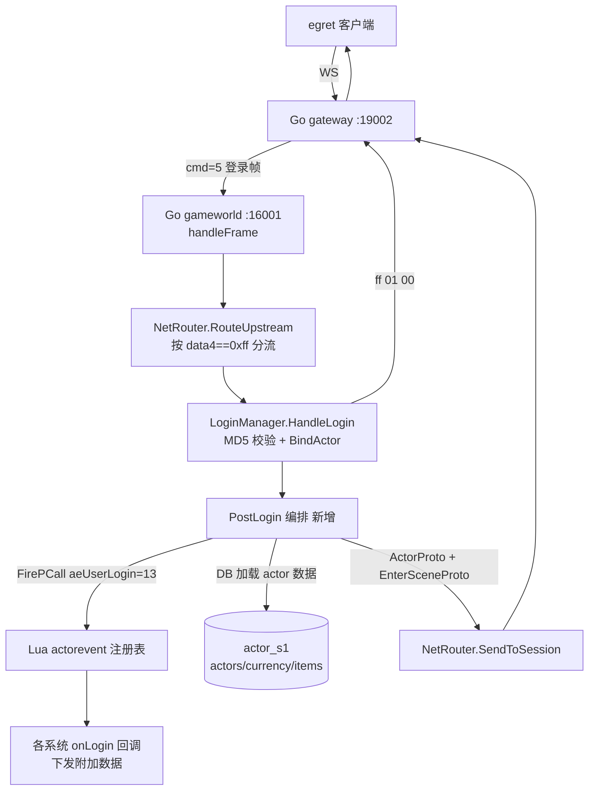

## 产品概述

针对「雷霆传奇」Go 重写工程的当前实际进度，确定并执行下一步：昨天已把“登录卡进度条”定位并修复到登录回包字节对齐，但玩家登录后仍无法真正进入游戏场景。本计划以补齐“登录成功之后到进入场景之前”的业务链为唯一目标，先固化已有成果，再按已在 C++ 原版中验证过的行为复刻，最终用隔离端口验证原客户端可无感进入场景。

## 核心功能

- **成果固化**：把昨天一整天分散在 19 个已修改文件与 58 个新增文件中的登录修复成果整理保存，避免继续开发时丢失。
- **登录后事件链**：登录校验通过后，按原版顺序触发登录事件、加载角色数据、建立场景连接，不再只回一个成功包就结束。
- **角色数据加载与建号**：已有角色从数据库读取身份、等级、货币、物品等数据；首次登录的低概率空角色路径建立新角色，避免登录成功后卡住。
- **进场景回包**：按原版协议下发角色数据与进场景数据，使原客户端从进度条进入实际游戏画面。
- **隔离验证与文档同步**：在不影响现网 C++ 服务的前提下，用隔离端口完成端到端验证，并把已确认的进度同步回工程文档。

## 技术栈选择

沿用项目现有技术栈，不引入新依赖：

- 服务端：Go（标准库 + gopher-lua v1.1.0 + go-sql-driver/mysql），自建 `netframe` 薄层
- 数据：MySQL `actor_s1`（`globaluser` / `actors`），内存 Actor 实体
- 协议：网关帧 14B 头 + cmd=5 payload；Lua 侧 `LDataPack` 组包，`OnActorEvent`/`OnNetMsg` 分发
- 验证：`wsprobe` 探针 + golden 抓包对拍 + 隔离端口（:19002 / :16001）

选择理由：M2 已用这套栈完成登录状态机并字节对齐，继续沿用可最小化改动面、复用已通过的测试基线。

## 实现策略

采用“先固化、再逆向确认、后实现验证”的顺序。

**为什么下一步是登录后业务链而非别的**：`docs/ROADMAP.md:71` 明确记录“剩余 M4 工作：登录后的完整业务逻辑（aeUserLogin 事件链、角色数据加载、进场景）”；只读核查证实 `login.go:156-161` 在密码校验通过后仅执行 `GetOrCreate` + `BindActor` + 回包 `[ff][01][00]`，既没有触发 `aeUserLogin`，也没有加载 actor 数据或下发进场景协议，这正是“登录成功却进不了游戏”的下一个真实卡点。`go test ./...` 全绿说明基础设施健康，具备继续推进的条件。

**关键决策与权衡**：

1. **先提交再开发（必要的前置）**：19 modified + 58 untracked 意味着昨天成果完全脆弱；但提交会把调试产物（`.raw` 抓包、`.exe~`、临时 backup bin）一并纳入，需人工筛选保留清单，只提交源码/文档/必要 golden，抓包与编译产物按 `.gitignore` 排除。这是低风险、高收益的一步。
2. **先协议终验、再编码**：`docs/protocol-frame.md:25-36` 标注长度前缀“高置信推断，待抓包终验”。直接凭推断写 ActorProto/EnterSceneProto 会产生大量返工。改用 `reference/captures/session004`–`session008` 的 c2g/g2c 成对 golden 与 Ghidra 符号（`Actor::Onlogin` 00604c12、`Actor::OnEnterScene` 0060948e、`GameEngine::LoadActorBasicData` 006468e0、`EnterSceneProto` 0060e11a）先锁定字节布局，再实现，确保一次对齐。用 `[subagent:code-explorer]` 做大范围跨目录梳理。
3. **事件链复用已有基础设施，不新建模式**：`registries.go:73` 的 `FirePCall` 与 `registries_test.go:64-76` 的 `aeUserLogin` 回调测试已证明事件链可用；直接复用 `NetRouter.SendToSession` 下发业务包，不另造下行通道。
4. **建号路径按幂等原则处理**：`actorID==0` 当前是静默空分支。补齐时以账号为唯一键建号并落库，重复登录幂等返回同一 actor，避免账号体系再次错位（昨天已修过一次 `globaldata.players` 与 `actor_s1.globaluser` 的错位）。
5. **热路径红线不动**：ADR-004 规定移动/AOI/攻击留 Go，本计划只碰登录一次性路径，不引入 Lua 热路径改动。

**性能与可靠性**：登录是每会话一次的非热路径，新增一次 DB 查询（按 actorID 加载）与一次 Lua 事件广播（`FirePCall` 带 500ms 看门狗）开销可控；`ActorManager` 已有 `sync.RWMutex`，新增数据字段沿用其锁语义；批量数据用一次查询聚合，避免逐字段 N+1 查询。

**避免技术债**：所有新接口扩展现有 `AccountStore`、`Engine`、`NetRouter`，不新增并行体系；协议常量引用 `functions/protocol.lua` 单一事实源，不硬编码魔法数字。

## 实现说明

- **现网保护**：Go 全栈验证一律使用隔离端口（网关 :19002 + gameworld :16001），C++ 网关 9002 / gameworld 6001 / dbserver 5001 全程不动；验证结束确认 C++ 服务恢复监听再收工。
- **日志**：复用现有 `slog`，在登录成功、事件触发、角色加载、进场景回包四个节点打点，沿用 `RUNBOOK` 中的关键字段名（sid / account / actorID），不打印密码或完整包体。
- **blast radius**：只改 `ltcq-go/internal/engineapi/*` 和 `cmd/gameworld` 胶水层，`docs/client-boundary.md` 红线内的 `main.min.js`、Lua 玩法层、PHP 门户一律不碰。
- **回归门槛**：每步完成后跑 `gofmt` + `go vet` + `go test ./...`，保持当前全绿基线；协议改动必须有 golden 字节对照。

## 架构设计

登录到进场景的数据流（本次修改聚焦在“登录成功后”的橙色链路）：



组件关系：`Engine` 组装 `Lua` / `Router` / `Timer` / `Login`；`BootstrapWithLogin` 在启用登录时安装 `PostLogin` handler，使登录成功后的编排与 M2 已验证的鉴权逻辑解耦。

## 目录结构

本次修改集中在 Go 服务端 engineapi 包与文档，前端与 Lua 资产零改动。

```
e:/雷霆传奇Linux版/www.wkzy.net_旧文件/
├── ltcq-go/
│   ├── internal/engineapi/
│   │   ├── login.go                 # [MODIFY] HandleLogin 成功后调用 PostLogin 编排；补 actorID==0 建号分支；保留已验证的 MD5 校验与回包字节不变。
│   │   ├── postlogin.go             # [NEW] 登录后业务链编排：触发 FirePCall(OnActorEvent, aeUserLogin)、加载 actor 数据、按 golden 顺序发 ActorProto/EnterSceneProto；失败只记日志不影响登录成功回包。
│   │   ├── postlogin_test.go        # [NEW] 单测：事件触发顺序、actor 数据加载、建号幂等、回包字节 golden 对照、Lua 回调超时隔离。
│   │   ├── accountstore.go          # [NEW/REFACTOR] 从 login.go 抽出 AccountStore 接口与 MySQL 实现，扩展 LoadActorData(actorID) 与 EnsureActor(account, userID)，一处聚合查询避免 N+1。
│   │   ├── actorstore.go            # [MODIFY] Actor 结构承载 DB 加载的 level/name/currency/items/staticVar；沿用 Dirty 脏标记与 RWMutex 语义。
│   │   ├── bootstrap.go             # [MODIFY] BootstrapWithLogin 在安装 LoginHandler 后安装 PostLogin handler，保持 dsn 为空时退化为无登录。
│   │   ├── netroute.go              # [MODIFY/VERIFY] 复用 SendToSession 下发进场景包；确认 cmd=5 分流登录帧的逻辑不被业务包 [0xff] 首字节误判。
│   │   └── registries.go            # [VERIFY] 确认 FirePCall 500ms 看门狗与 aeUserLogin 常量注入可用，无需改动则保持原样。
│   ├── cmd/gameworld/main.go        # [VERIFY] 帧分派与 BootstrapWithLogin 调用链接入 PostLogin，启动参数不变（-listen/-data/-ostype/-dsn）。
│   └── reference/captures/          # [VERIFY] 只读使用 session004–008 c2g/g2c golden 逆向协议布局，不修改现有抓包文件。
├── docs/
│   ├── ROADMAP.md                   # [MODIFY] 更新 M2/M4 状态表：登录后业务链完成，标注下一里程碑（M4 4.6 场景实体 / 打怪）。
│   ├── RUNBOOK.md                   # [MODIFY] 新增“九、登录后进场景验证”小节，记录隔离端口命令、golden 对照结果与恢复 C++ 网关步骤。
│   └── protocol-frame.md            # [MODIFY] 把长度前缀从“高置信推断”回填为抓包终验结论，补 ActorProto/EnterSceneProto 字节布局。
└── .gitignore                       # [MODIFY] 排除 *.exe~、runtime/*.bin、调试用 .raw 新增文件，避免提交时误纳入调试产物。
```

## 关键代码结构

登录后编排的接口契约（建议定义，具体字段以 golden 逆向结果为准）：

```
// PostLoginHandler 在登录鉴权成功、BindActor 完成后调用。
// 实现方负责触发 aeUserLogin、加载 actor 数据并下发进场景协议；
// 任一子步骤失败只记录日志，不改变已发出的登录成功回包。
type PostLoginHandler interface {
    HandlePostLogin(sid uint16, actorID int, account string) error
}

// AccountStore 扩展登录校验之外的一次性数据加载，避免逐字段查询。
type AccountStore interface {
    CheckPassword(account, md5pass string) (int, bool, error)
    ActorIDByAccount(account string) (int, error)
    LoadActorData(actorID int) (*ActorData, error)
    EnsureActor(account string, userID int) (int, error)
    Close()
}
```

## Agent Extensions

### SubAgent

- **code-explorer**
- Purpose: 以 very thorough 深度跨 `reference/captures/`、`reference/ghidra/functions.tsv`、`data/server/s1/.../functions/` 与 `docs/` 梳理 C++ 登录成功到进场景的完整链路：aeUserLogin 触发时机、actor 数据来源表、ActorProto/EnterSceneProto 字段顺序与字节 golden。
- Expected outcome: 产出可执行的协议布局与事件顺序清单，列出每个字段对应的 golden 偏移或 Ghidra 函数地址，作为 `postlogin.go` 实现的直接依据。

### Skill

- **lsp-code-analysis**
- Purpose: 在改动 `AccountStore`、`Engine`、`NetRouter` 接口后做符号引用与影响分析，确认所有调用点（含测试）已同步，定位遗漏的 stub 实现。
- Expected outcome: 给出受影响符号的完整引用清单与编译风险点，保证接口扩展后 `go test ./...` 仍全绿。

- **agent-browser**
- Purpose: 在隔离端口 Go 全栈起来后，用真实浏览器客户端打开本地门户，走登录→进场景流程，截图并抓 WS 消息，判断是否真正进入游戏画面而非停在进度条。
- Expected outcome: 提供“已进场景/仍卡进度条”的明确判定与失败时的关键请求响应证据。