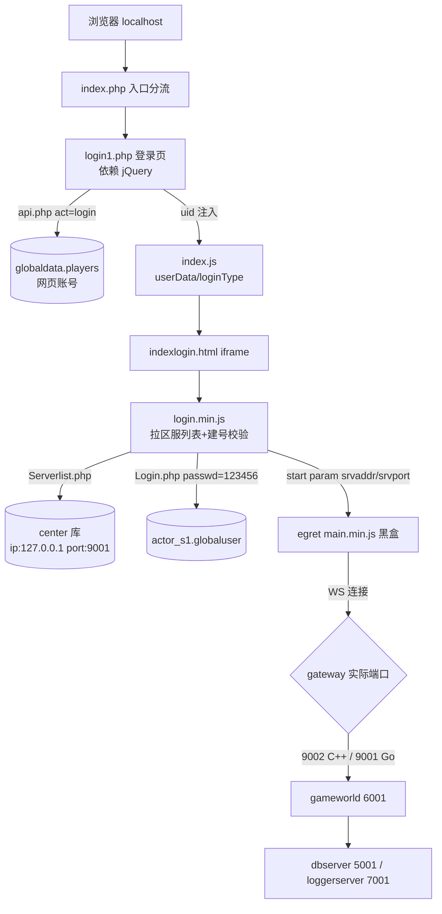

## 产品概述

修复「雷霆传奇」项目在本地 EServer 环境（http://localhost/）下"游戏进不去"的登录故障。由于症状描述笼统，采用"先诊断定位卡点、再针对性修复、最后端到端验证"的策略，避免盲目改动。

## 核心功能

- **登录链路诊断**：确认故障发生在登录页加载、账号校验、区服列表拉取、网关连接还是 gameworld 就绪阶段；核对当前运行的是 C++ 网关（实际监听 9002）还是 Go 网关（默认 9001/后端 6002）、数据库与服务启动顺序状态。
- **配置与代码修复**：对齐区服列表下发端口与实际网关监听端口；将登录页外网 jQuery 改为本地文件；修复 `?uid=xxx` 路径下 userData 字段缺失；排查两套账号体系（globaldata.players 与 actor_s1.globaluser）错位。
- **端到端验证**：从门户登录到进入游戏的完整流程验证，含浏览器控制台/网络抓包、接口直连测试，必要时同步修正运维文档的端口表。

## 技术栈选择

沿用项目现有技术栈，不引入新依赖：PHP + nginx（EServer 集成环境）、MySQL 5.7、egret H5 客户端（`main.min.js` 为不可修改的黑盒）、C++ 四进程服务端 / Go 重写网关、hosts 域名映射。

## 实现策略

采用**诊断优先、最小改动**策略。先用浏览器自动化与只读检查确定真实卡点，再仅修复被证实的缺陷。关键判断依据：

1. 端口矛盾确定性最高——区服列表下发 9001（`data/h5game/web/server_list/config.php:36`），C++ 网关实际监听 9002（`data/server/s1/Debug/gateway/GateWay.txt:10`），二者必居其一需对齐；GO 网关后端默认 6002 与 gameworld 6001 不符（`ltcq-go/cmd/gateway/main.go:94-95`）。
2. 登录页强依赖外网 jQuery（`login1.php:20`、`index1.php:20`、`index2.php:20`），本地无外网时事件绑定失效；仓库已有 `jquery-1.10.1.min.js` 可直接复用。
3. `index.js:47-69` 的 userData 默认字段仅在无查询串时生效，`index.html?uid=xxx`（`login1.php:158`）会覆盖为仅 `{uid}`，注释明确缺字段的登录包被 gameworld 拒绝。
4. 账号体系错位：网页登录写 `globaldata.players`，进游戏校验走 `actor_s1.globaluser` 且固定密码 md5("123456")（`login.min.js:214` 硬传 passwd=123456）。
5. 边界红线：`docs/client-boundary.md` 明确 `main.min.js` 不可改，所有改动限定在胶水层（index.js / login.min.js / indexlogin*.html / web/** PHP / 静态资源）。

## 实现细节

- **诊断步骤**：按 `docs/RUNBOOK.md:3-7` 确认启动顺序 dbserver → gameworld → gateway → loggerserver，检查 gameworld 是否出现 "all game config load complete"；用浏览器工具查看 F12 控制台报错与网络请求（区服列表 `Serverlist.php`、建号接口 `web/s10001/Login.php` 的返回值）；直连接口验证 `http://localhost/web/server_list/Serverlist.php/?account=test` 与 `web/s10001/Login.php?account=test&passwd=123456` 的响应。
- **端口修复**：以诊断确认的实际运行网关为准收敛到单一端口——若运行 C++ 网关，将区服列表 port 改为 9002（保留 GateWay.txt 不动）；若运行 Go 网关，修正其后端端口为 6001。使用精确替换而非整体重写，并同步修正 `docs/RUNBOOK.md:18` 端口表。
- **jQuery 本地化**：将三个登录页的 `<script src="http://libs.baidu.com/jquery/2.1.4/jquery.min.js">` 改为本地 `jquery-1.10.1.min.js` 路径，保持 `funcChina`/`checkUserName` 依赖不变。
- **userData 合并**：修改 `index.js` 的 URL 参数解析逻辑，使默认字段与 URL 参数合并而非二选一，确保 `?uid=xxx` 路径仍携带 sdkloginmodel/channelExt/game_appid/pid 等字段。
- **缓存与验证**：验证前强制 Ctrl+F5 清除 nginx 对 js 的 1h 缓存（`docs/RUNBOOK.md:45`）；`login.min.js:39-43` 会运行时覆盖 pf/pt/loginType，改动外层变量时需同步核对。
- **风险控制**：仅改胶水层与配置，不碰 egret 黑盒与 Lua 玩法层；每处改动对照原版基线日志验证；遵循 `docs/compatibility.md` 三方版本同列约束。

## 架构设计

登录链路组件关系如下：



## 目录结构

```
e:/雷霆传奇Linux版/www.wkzy.net_旧文件/
├── data/h5game/
│   ├── web/server_list/config.php   # [MODIFY] 区服列表配置：将 port 9001 对齐到诊断确认的实际网关监听端口；核对 pf='test' 与 ip。
│   ├── login1.php                   # [MODIFY] 登录页：外网 jQuery 改本地 jquery-1.10.1.min.js；保持登录表单与 api.php 提交逻辑。
│   ├── index1.php                   # [MODIFY] 同上，替换外网 jQuery 引用。
│   ├── index2.php                   # [MODIFY] 同上，替换外网 jQuery 引用。
│   ├── index.js                     # [MODIFY] 合并默认 userData 字段与 URL 参数，确保 ?uid=xxx 路径登录包字段完整；不改动 start() 与 manifest 加载链。
│   ├── web/s10001/Login.php         # [MODIFY/VERIFY] 进游戏建号校验：核对 actor_s1.globaluser 库表可用性与固定密码逻辑，按诊断结果修正账号体系错位。
│   └── api.php                      # [VERIFY] 网页登录/注册接口：核对 globaldata.players 读写与返回码，仅在诊断确认异常时修改。
├── data/server/s1/Debug/gateway/GateWay.txt  # [VERIFY] 确认 C++ 网关监听端口 9002 与 BackServer 6001；仅在选择统一到 9001 时修改。
├── ltcq-go/cmd/gateway/main.go      # [VERIFY/MODIFY] 若运行 Go 网关，核对默认监听 9001 与后端端口（当前 6002 需改为 6001）。
└── docs/RUNBOOK.md                  # [MODIFY] 端口表与故障表：按最终统一的网关端口更新，并记录本次修复要点。
```

## 关键代码结构

userData 合并逻辑的核心契约（仅示意，不改变现有字段集）：

```javascript
// 目标：URL 参数覆盖默认字段，而非完全替换
window['userData'] = Object.assign(
  { uid:'', user_id:'', openId:'', sdkloginmodel:'0', channelExt:'', game_appid:'1', pid:'1' },
  urlParams
);
```

## Agent Extensions

### Skill

- **agent-browser**
- Purpose: 在本地环境打开 http://localhost/，检查登录页渲染、F12 控制台报错与网络请求（区服列表、建号接口响应），定位"游戏进不去"的具体卡点。
- Expected outcome: 产出故障发生阶段的判定（登录页/账号校验/区服列表/网关连接/gameworld 就绪）及关键请求响应证据。

### SubAgent

- **code-explorer**
- Purpose: 在诊断阶段按需要快速核对分散在 PHP、JS 配置与 Go/C++ 网关配置中的端口与账号库表引用，确保修复无遗漏。
- Expected outcome: 给出所有 port 9001/9002/6001/6002 及 globaluser/players 引用点的完整清单，支撑一次性改全。